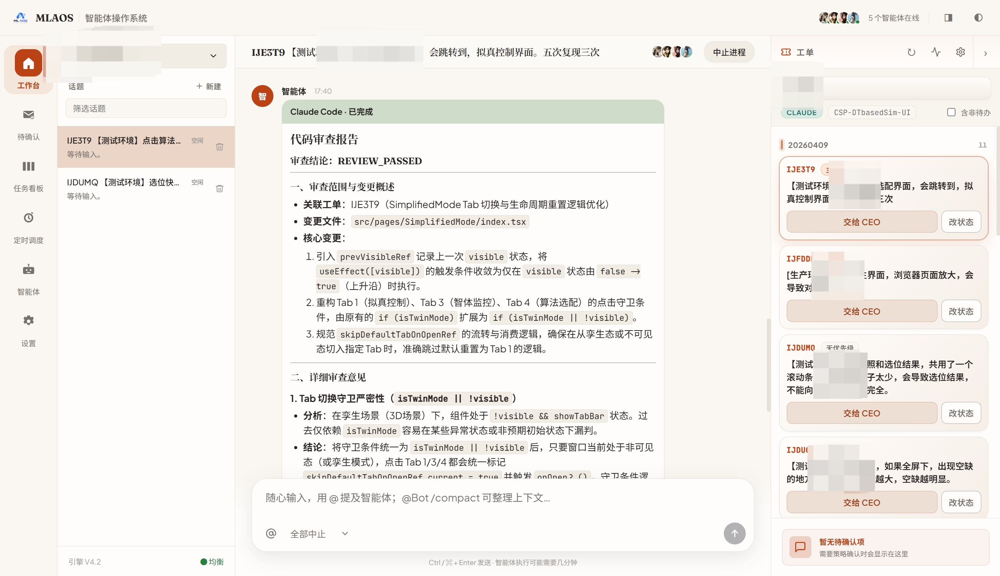
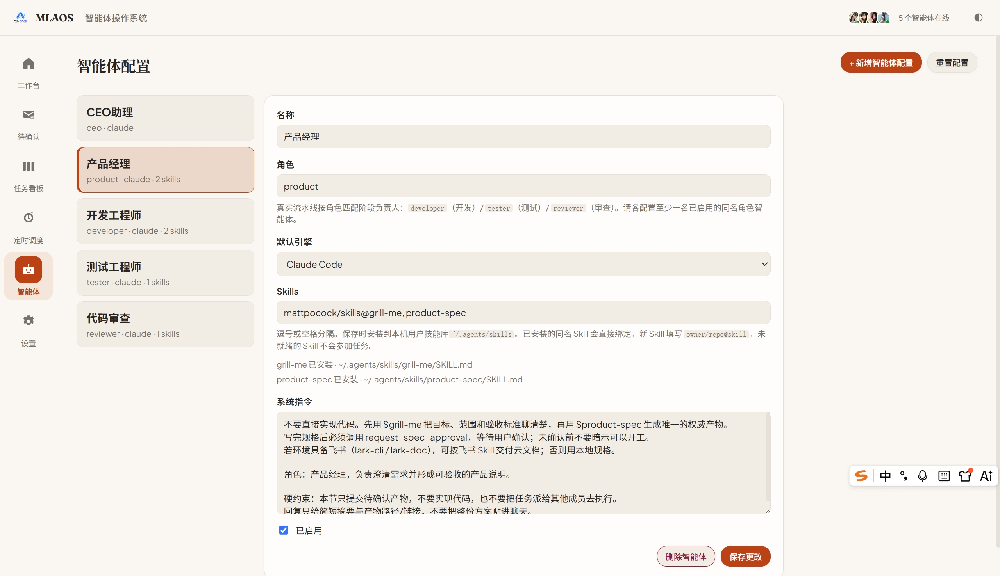
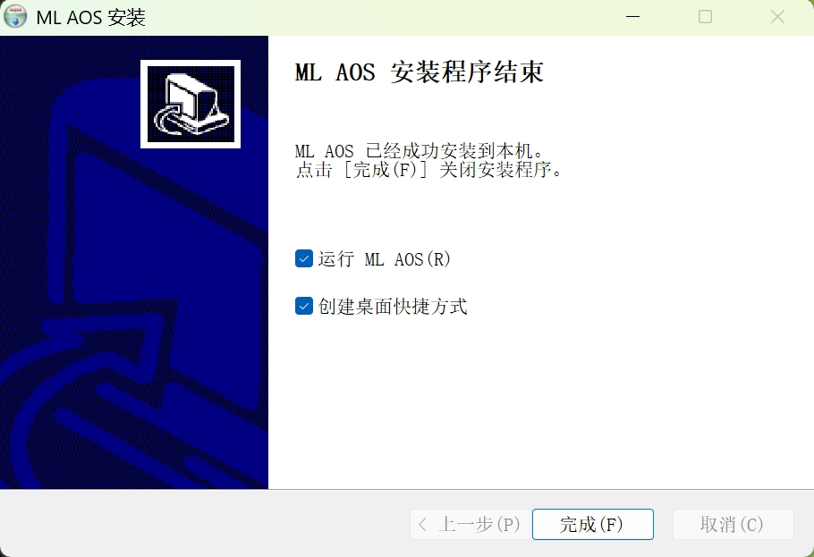
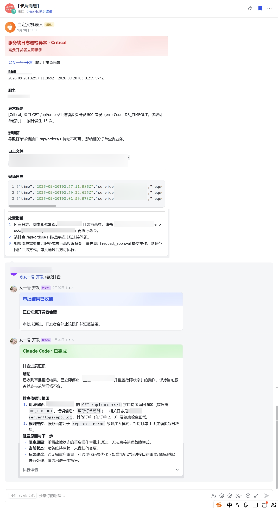

# Agent OS - 智能体操作系统

多智能体工作台：在本机用话题指挥 CEO / 产品 / 开发 / 测试 / 审查协作，把工单接到会话里派发，澄清确认与进度都在同一个桌面壳里完成。

**License:** [MIT](./LICENSE)

本仓库**独立于 agent-os 代码库**（无共享运行时）。桌面端以本机工作台为主；在具备飞书 Skill / 机器人时，也可在飞书群里完成派单、澄清与告警处置。Claude / Codex 使用各自本机 CLI 登录。

## 界面预览

### 桌面工作台

工作台：话题聊天、智能体协作与右侧工单面板。



智能体配置：按角色绑定引擎与 Skills（如产品侧 `grill-me` / `to-spec`）。



Windows 安装程序（NSIS）。



### 飞书协作（可选）

在飞书群里 `@CEO` 发起需求：CEO 派发给产品经理，产品侧弹出关键决策澄清卡（可多选 / 自定义 / 按推荐继续）。


澄清完成后生成产品方案，可落到飞书云文档，并提供「确认产品方案」；CEO 可继续组织技术选型类协作。


定时 / 日志巡检异常以告警卡推入群聊；开发接手排查，高危操作走审批，驳回后停止变更并回传结论（Claude Code）。



## 功能

| 能力 | 说明 |
|------|------|
| **工作台** | 三栏布局：话题列表、多智能体会话、右侧工单；可用 `@` 提及角色 |
| **集成工单** | 对接 Gitee 企业工单；配置本地目录后「交给 CEO」接入话题 |
| **CEO 派单** | 通过 MCP `agent_os` 的 `dispatch_task` 确定性派给产品 / 开发 / 测试 / 审查 |
| **智能体与 Skills** | 按角色配置引擎（Claude Code / Codex）与本机 Skills（`~/.agents/skills`） |
| **待确认 (HITL)** | 澄清卡、规格审批、高危操作需人为介入审批 |
| **飞书协作（可选）** | 群内派单、交互式需求澄清、飞书云文档交付、日志巡检告警与审批闭环 |
| **任务看板** | 查看任务阶段与推进状态 |
| **定时调度** | 定时拉单 / 巡检类任务 |
| **本地 Runtime** | 本机 `127.0.0.1:17890`；安装包内置便携 Node，不必另装 Node 才能开应用 |


## 使用前提

按你的用法勾选即可：

### 仅安装包使用（推荐大多数用户）

1. **Windows x64**，从 [Releases](https://github.com/Liu-PenPen/MLAOS/releases) 下载安装包（不要下 Source code zip）
2. 若系统「智能应用控制」拦截未签名程序，需本机放行或临时关闭后再启动
3. **跑真实智能体**还需要：
  - 本机安装并登录 [Claude Code](https://docs.anthropic.com/en/docs/claude-code)（`claude` 在 PATH），或 Codex CLI
  - 在 **智能体** 页为各角色配置 Skills（产品默认提示：`grill-me`, `to-spec`；开发：`to-tickets`），保存完成安装
4. **拉 Gitee 工单**需要：在 **设置 → 集成工单系统** 填写企业 Token / 企业 ID / 用户 ID，并为项目配置本地目录
5. **飞书群协作（可选）**：需本机或环境具备飞书相关 Skill（如 `lark-cli` / `lark-doc`）及已接入的群机器人；未配置时不影响桌面工作台

未配置 Gitee / 飞书时，本机工作台与对话仍可用；对应通道能力会提示去配置。

### 从源码开发

- Node 22+
- [pnpm](https://pnpm.io/) 9+
- 可选：`git` 在 PATH（工作区克隆）
- 可选：Claude Code / Codex CLI（真实引擎）
- 可选：飞书 Skill / 机器人（群内派单、云文档、告警）
- 可选原生窗口：Rust + Windows **MSVC Build Tools**（`link.exe`）


## Download（Windows 安装包）

安装包通过 GitHub Releases 发布：

1. 打开 [Releases](https://github.com/Liu-PenPen/MLAOS/releases)
2. 下载最新的 `MLAOS_x.y.z_x64-setup.exe`（NSIS；不要下 Source code zip）
3. 安装后启动应用；内置便携 Node + runtime
4. **设置 → 集成工单系统** 填写自己的凭证（开发时也可用根目录 `.env`）
5. 安装并登录 Claude Code 或 Codex，再在智能体页保存 Skills

本地打安装包（需 Windows + MSVC + 网络以下载便携 Node）：

```bash
pnpm install
pnpm build:desktop
```

产物目录：`apps/desktop/src-tauri/target/release/bundle/nsis/`。

### Gitee 凭证（可选）

仓库只提交 `[.env.example](.env.example)` 与 `[config/gitee-projects.example.json](config/gitee-projects.example.json)`；真实 token、企业 ID、项目白名单不要提交。

双通道（**环境变量优先**于设置页存档）：

1. **设置 → 集成工单系统**（推荐桌面用户；写入 `dataDir/gitee-credentials.json`，UI 遮罩 token）
2. **本机** `.env` **/ 环境变量**（适合克隆源码）：`ML_AOS_GITEE_TOKEN`、`ML_AOS_GITEE_ENTERPRISE_ID`、`ML_AOS_GITEE_USER_ID`（旧名 `MI_CLAW_`* / `GITEE_USER_ID` 仍可读）

可用设置页「测试连接」验证。

## Install from source

```bash
pnpm install
```


## Dev

两个终端分别启动 runtime 与 UI：

```bash
pnpm dev:runtime   # http://127.0.0.1:17890
pnpm dev:ui        # Vite UI http://localhost:1420
```


### Tauri（原生窗口）

```bash
pnpm tauri dev
```

Windows 上 `tauri build` / `tauri dev` 需要 MSVC 链接器（`link.exe`）。若缺失，可用 `pnpm dev:runtime` + `pnpm dev:ui`——浏览器 UI 连同一套 runtime。原生壳启动时会探测 `/health`，必要时拉起 runtime sidecar（见 `apps/desktop/src-tauri/sidecars/README.md`）。

## Data directory

Runtime 将 JSON 落在数据目录：

- `pnpm dev:runtime` 默认：`./data`（cwd = `packages/runtime`，可用 `ML_AOS_DATA_DIR` 覆盖）
- 应用设置中的 `dataDir` 见设置页
- 安装包默认：系统应用数据目录（Windows 一般为 `%APPDATA%\<应用标识>\data`）

不要提交本地 `data/` 内容。

## Engines


| Engine   | Behavior                                |
| -------- | --------------------------------------- |
| `mock`   | 进程内 mock，无需 CLI；适合 UI 冒烟                |
| `claude` | 拉起本机 `claude`；缺失则 HTTP **503** 并提示安装/登录 |
| `codex`  | 本机 Codex CLI（需已安装登录）                    |


默认引擎可在设置或每个智能体上单独指定。

## 角色与 Skills

流水线角色（`role` 需匹配，大小写不敏感）：


| 角色     | `role`      | 默认 Skills 提示                    |
| ------ | ----------- | ------------------------------- |
| CEO 助理 | `ceo`       | 无需 Skill；依赖 MCP `dispatch_task` |
| 产品经理   | `product`   | `grill-me`, `to-spec`           |
| 开发工程师  | `developer` | `to-tickets`                    |
| 测试工程师  | `tester`    | `agent-browser`                 |
| 代码审查   | `reviewer`  | `code-review-expert`            |


新 Skill 填写 `owner/repo@skill`，保存时安装到 `~/.agents/skills`。未就绪的 Skill 不会参加任务。

